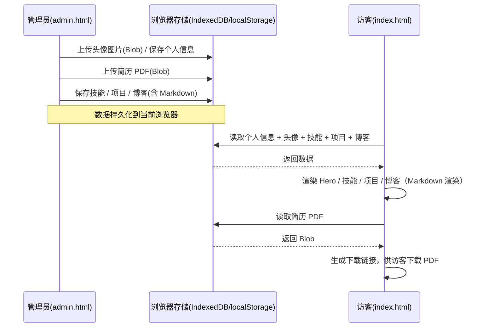

# 角色交互文档（AGENTS）：个人展示网站

| 项目 | 内容 |
| --- | --- |
| 文档版本 | v1.0 |
| 更新日期 | 2026-10-15 |

本文档描述本网站中两个角色的职责，以及各自的完整访问交互流程。

---

## 1. 角色定义

| 角色 | 入口 | 权限 | 说明 |
| --- | --- | --- | --- |
| 普通访客（Visitor） | `docs/index.html` | 只读 | 浏览个人信息、技能、项目、博客，下载简历 PDF |
| 网站管理员（Admin） | `docs/admin.html` | 读写 | 在线维护全部展示内容，数据存于浏览器本地 |

> 说明：本网站为纯前端应用，数据保存在**当前浏览器**的 IndexedDB 与 localStorage 中。管理员在哪个浏览器录入，数据就保存在哪个浏览器；访客通过部署后的站点访问同一份（该浏览器内的）展示数据。

---

## 2. 普通访客交互流程

### 2.1 流程总览

```
访客打开 index.html
    │
    ├─ 1. 浏览 Hero（头像 / 姓名 / 简介 / 联系方式）
    ├─ 2. 查看技能列表（进度条）
    ├─ 3. 查看项目 → 点击卡片 → 弹窗阅读 Markdown 详情
    ├─ 4. 查看博客 → 点击卡片 → 弹窗阅读 Markdown 全文
    └─ 5. 点击「下载简历 PDF」→ 浏览器下载 PDF 文件
```

### 2.2 逐步说明

1. **进入首页**：加载 `index.html`，自动从浏览器本地读取并渲染数据。
2. **查看个人主页**：页面顶部展示头像、姓名、个人简介；若管理员填写了邮箱 / 城市 / GitHub / 个人网站，以标签形式展示（可点击跳转）。
3. **查看技能**：向下滚动到「我的技能」，以卡片 + 进度条查看技能与熟练度。
4. **查看项目**：在「项目作品」区浏览项目卡片（标题、简介、标签）；点击任意卡片，弹出详情窗口，渲染该项目 Markdown 正文（支持标题、列表、代码块、表格等）。
5. **查看博客**：在「博客文章」区浏览文章卡片；点击卡片弹出全文，渲染 Markdown。
6. **下载简历**：若管理员已上传简历，点击「下载简历 PDF」即可下载；未上传时该按钮隐藏。
7. **退出 / 关闭**：关闭详情弹窗（点击遮罩、右上角 × 或按 Esc 键）。

---

## 3. 网站管理员交互流程

### 3.1 流程总览

```
管理员打开 admin.html
    │
    ├─ 1. 基本信息：上传头像、上传简历、编辑个人简介 → 保存
    ├─ 2. 技能管理：新增 / 行内编辑 / 删除技能
    ├─ 3. 项目管理：新建 / 编辑 / 删除项目 + Markdown 分屏编辑器
    └─ 4. 博客管理：新建 / 编辑 / 删除博客 + Markdown 分屏编辑器
```

### 3.2 逐步说明

#### （1）基本信息
- **上传头像**：点击「选择图片上传」，从本地选择图片文件，上传后左侧预览立即更新，图片保存到 IndexedDB。
- **编辑简介**：填写姓名、个人简介、邮箱、所在城市、GitHub、个人网站。
- **上传简历**：点击「上传 PDF」，选择 PDF 文件；上传后显示文件名与大小；可点击「删除」移除。
- **保存**：点击「保存基本信息」，个人简介写入 localStorage，头像 / 简历已在上传时自动保存。

#### （2）技能管理
- **新增**：输入技能名称、拖动熟练度滑块，点击「添加技能」。
- **编辑**：在列表行内直接修改名称（失焦保存）或拖动熟练度（实时保存）。
- **删除**：点击行内「删除」。

#### （3）项目管理
- **新建**：点击「新建项目」，进入编辑器；填写标题、链接、简介、标签。
- **Markdown 分屏编辑**：左侧输入 Markdown 源码，右侧 120ms 内实时预览渲染效果。
- **保存**：点击「保存项目」，项目（含 Markdown）保存到 IndexedDB，返回列表。
- **编辑 / 删除**：在列表中点击「编辑」重新进入编辑器；点击「删除」经确认后删除。

#### （4）博客管理
- 与项目管理操作一致：新建 / 编辑 / 删除，使用同样的 Markdown 分屏实时预览编辑器，保存为 Markdown 数据。

---

## 4. 完整交互时序（管理员维护 → 访客查看）



---

## 5. 异常与边界场景

| 场景 | 表现 |
| --- | --- |
| 未上传头像 | 前台展示姓名首字母 / 默认占位图标 |
| 未填写姓名 / 简介 | 前台显示默认欢迎语与提示文案 |
| 未上传简历 | 前台自动隐藏「下载简历 PDF」按钮 |
| 无技能 / 项目 / 博客 | 各区块显示空状态提示 |
| 上传非图片 / 非 PDF 文件 | 后台提示错误，拒绝保存 |
| 浏览器不支持 IndexedDB | 数据层捕获异常并提示 |
| 内容含恶意 HTML | Markdown 渲染经 DOMPurify 净化，避免 XSS |

---

## 6. 部署与提交操作步骤

> 详细命令以「本地保存文件 → Git 推送 → Cloudflare Pages 部署 → 截图提交」四步为准，见作业说明；此处简述流程。

1. **本地保存文件**：将本仓库全部文件（PRD.md、TECH_DESIGN.md、AGENTS.md、docs/）保存到本地项目目录。
2. **Git 推送 GitHub**：初始化仓库、提交并推送到 GitHub 远程仓库。
3. **Cloudflare Pages 部署**：连接 GitHub 仓库，Build output directory 设为 `docs`，部署。
4. **作业提交截图**：截取以下页面作为提交凭证（详见作业说明）。
